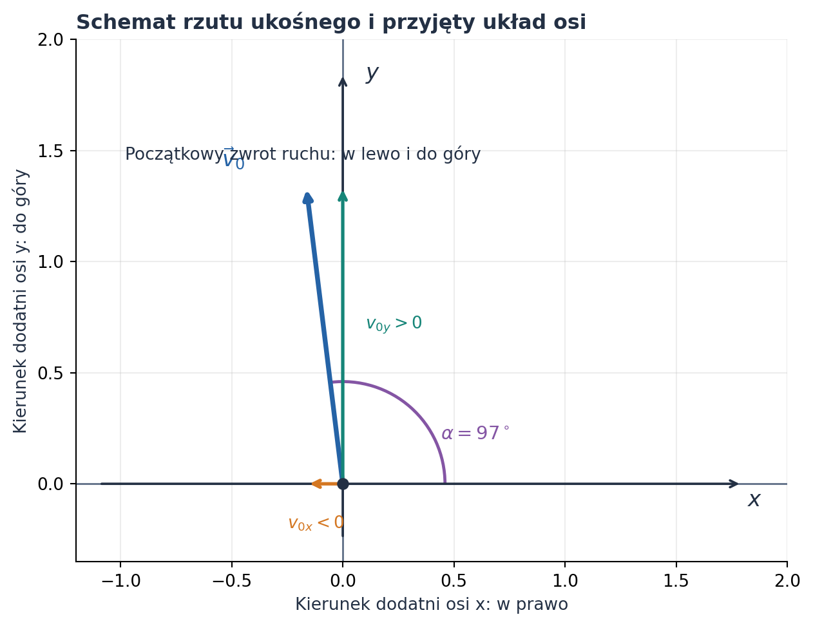
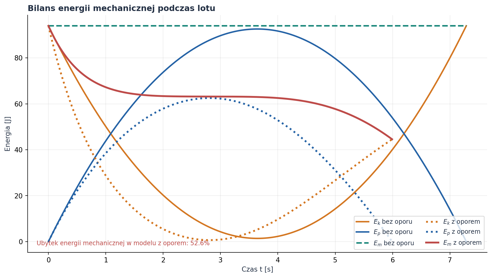
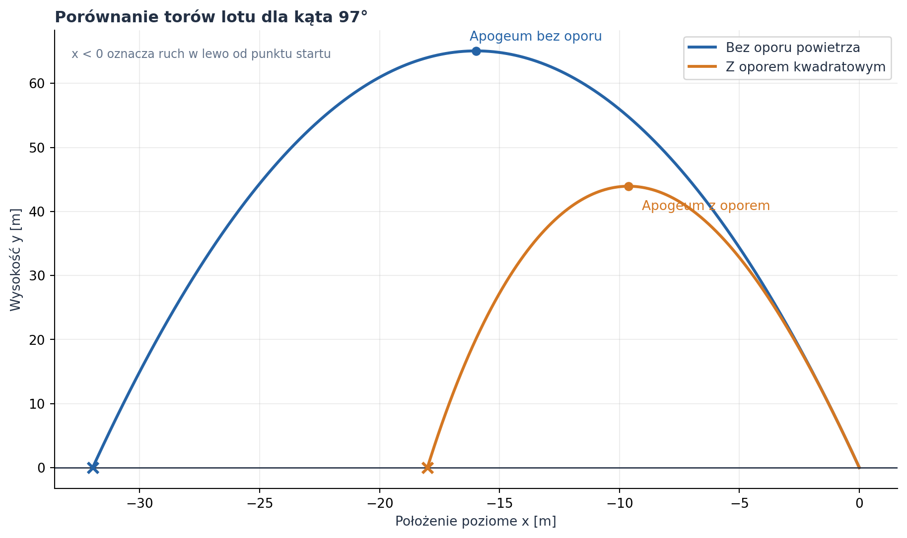
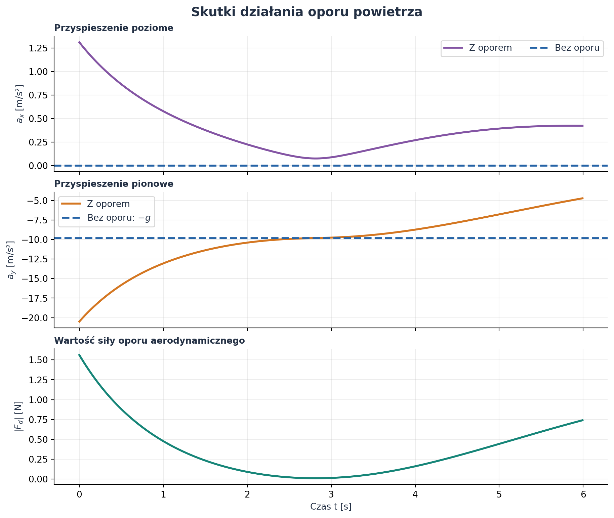
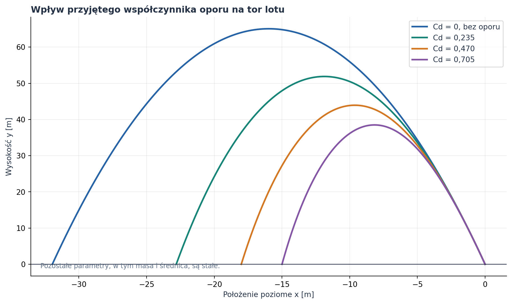
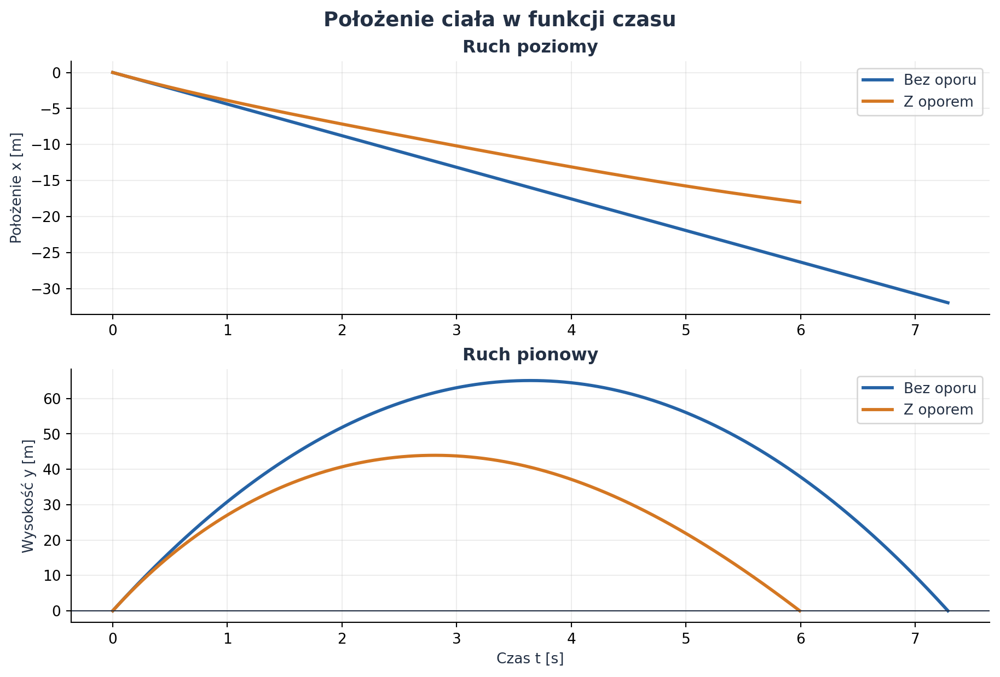

# Rzut ukośny bez oporu i z oporem powietrza

*Raport obliczeniowy: wyprowadzenie równań, porównanie modeli, symulacja numeryczna i wykresy wykonane w Pythonie.*

**Temat:** ruch ciała wyrzuconego pod kątem do poziomu — model idealny i model z kwadratowym oporem powietrza.  
**Dane z indeksu:** 3697.  
**Parametry zadane:** prędkość początkowa $v_0=36\,\mathrm{m/s}$ oraz kąt początkowy $\alpha=97^\circ=1{,}692969\,\mathrm{rad}$.  
**Metoda:** wyprowadzenie analityczne dla ruchu bez oporu oraz całkowanie numeryczne równań ruchu z oporem kwadratowym.  
**Charakter danych:** przykład modelowy; wykresy nie przedstawiają pomiarów laboratoryjnych.

Rzut ukośny jest ruchem, w którym ciało otrzymuje prędkość początkową skierowaną pod kątem do poziomu, a następnie porusza się pod wpływem grawitacji. W modelu idealnym pomijamy oddziaływanie powietrza. W modelu rzeczywistym wprowadzamy siłę aerodynamiczną, która zależy od prędkości ciała i zmienia zarówno tor, jak i czas lotu.

Ważna konsekwencja danych z indeksu: kąt $97^\circ$ jest większy od $90^\circ$. Przy standardowej konwencji, w której kąt mierzy się przeciwnie do ruchu wskazówek zegara od dodatniego kierunku osi $x$, początkowa składowa pozioma prędkości jest ujemna. Ciało wznosi się więc w lewo, a następnie opada.

## Spis treści

1. [Cel i model fizyczny](#1-cel-i-model-fizyczny)
2. [Rzut ukośny bez oporu powietrza](#2-rzut-ukośny-bez-oporu-powietrza)
3. [Przykład liczbowy i przebiegi czasowe bez oporu](#3-przykład-liczbowy-i-przebiegi-czasowe-bez-oporu)
4. [Energia mechaniczna](#4-energia-mechaniczna)
5. [Rzut ukośny z oporem kwadratowym](#5-rzut-ukośny-z-oporem-kwadratowym)
6. [Porównanie modeli i wpływ współczynnika oporu](#6-porównanie-modeli-i-wpływ-współczynnika-oporu)
7. [Zestawienie wyników i kontrola obliczeń](#7-zestawienie-wyników-i-kontrola-obliczeń)
8. [Kod i odtwarzanie wykresów](#8-kod-i-odtwarzanie-wykresów)
9. [Ograniczenia modelu](#9-ograniczenia-modelu)
10. [Wnioski i dalsza lektura](#10-wnioski-i-dalsza-lektura)

---

## 1. Cel i model fizyczny

### 1.1. Cel opracowania

Celem raportu jest opisanie ruchu ciała w rzucie ukośnym w dwóch wariantach:

- **bez oporu powietrza** — na ciało działa wyłącznie siła ciężkości;
- **z oporem powietrza** — na ciało działa siła ciężkości oraz aerodynamiczna siła oporu proporcjonalna do kwadratu szybkości.

Porównane zostaną położenie, prędkość, przyspieszenie, maksymalna wysokość, czas lotu, zasięg poziomy i energia mechaniczna. Wykresy zostały utworzone z obliczeń wykonanych w Pythonie.

### 1.2. Przyjęty układ współrzędnych

Początek układu współrzędnych umieszczamy w punkcie wyrzutu. Oś $x$ jest pozioma i skierowana w prawo, a oś $y$ pionowa i skierowana do góry. Poziom wyrzutu jest równocześnie poziomem lądowania, dlatego $y_0=0\,\mathrm{m}$.

Kąt $\alpha$ jest mierzony od dodatniego kierunku osi $x$ przeciwnie do ruchu wskazówek zegara. W obliczeniach numerycznych kąt jest zapisany w radianach:

$$
\alpha=97^\circ\cdot\frac{\pi}{180^\circ}
=1{,}692969\,\mathrm{rad}.
$$



*Rysunek 1. Schemat rzutu i konwencja znaków. Ponieważ $\alpha=97^\circ$, składowa $v_{0x}$ jest ujemna, a $v_{0y}$ dodatnia.*

### 1.3. Założenia fizyczne

1. Ziemskie pole grawitacyjne jest jednorodne, a przyspieszenie grawitacyjne ma stałą wartość $g=9{,}81\,\mathrm{m/s^2}$.
2. Punkt startu i poziom lądowania znajdują się na tej samej wysokości.
3. Wiatr nie występuje; powietrze jest nieruchome względem Ziemi.
4. Ciało modelujemy jako kulę o stałej masie i średnicy.
5. W modelu z oporem przyjmujemy stałą gęstość powietrza i stały współczynnik oporu aerodynamicznego.
6. Pomijamy obrót ciała, siłę Magnusa, wypór powietrza oraz zmiany parametrów atmosfery z wysokością.

Parametry ciała i powietrza nie wynikają z numeru indeksu. Aby można było obliczyć konkretny przykład, przyjęto jawne parametry modelowe zebrane w tabeli 1. Wartości te są założeniami obliczeniowymi, a nie wynikami pomiaru.

### 1.4. Dane i symbole

| Symbol | Znaczenie | Wartość w przykładzie | Jednostka SI |
| :--- | :--- | ---: | :---: |
| $v_0$ | szybkość początkowa | $36{,}000$ | $\mathrm{m/s}$ |
| $\alpha$ | kąt początkowy | $1{,}692969$ | $\mathrm{rad}$ |
| $g$ | przyspieszenie grawitacyjne | $9{,}81$ | $\mathrm{m/s^2}$ |
| $y_0$ | wysokość początkowa | $0$ | $\mathrm{m}$ |
| $m$ | masa kuli | $0{,}145$ | $\mathrm{kg}$ |
| $d$ | średnica kuli | $0{,}073$ | $\mathrm{m}$ |
| $S$ | pole przekroju poprzecznego kuli | $0{,}004185$ | $\mathrm{m^2}$ |
| $\rho$ | gęstość powietrza | $1{,}225$ | $\mathrm{kg/m^3}$ |
| $C_d$ | współczynnik oporu aerodynamicznego | $0{,}470$ | $1$ (bezwymiarowy) |
| $\beta$ | parametr w równaniu ruchu z oporem | $0{,}008309$ | $\mathrm{m^{-1}}$ |
| $t$ | czas | zmienna | $\mathrm{s}$ |
| $x,y$ | współrzędne położenia | zmienne | $\mathrm{m}$ |
| $v_x,v_y$ | składowe prędkości | zmienne | $\mathrm{m/s}$ |
| $a_x,a_y$ | składowe przyspieszenia | zmienne | $\mathrm{m/s^2}$ |
| $E_k,E_p,E_m$ | energia kinetyczna, potencjalna i mechaniczna | zmienne | $\mathrm{J}$ |

Dla kuli pole przekroju poprzecznego wynosi:

$$
S=\pi\left(\frac{d}{2}\right)^2
=\frac{\pi d^2}{4}
=0{,}004185\,\mathrm{m^2}.
$$

## 2. Rzut ukośny bez oporu powietrza

### 2.1. Rozkład prędkości początkowej

Wektor prędkości początkowej rozkładamy na składową poziomą i pionową:

$$
 v_{0x}=v_0\cos\alpha,
 \qquad
 v_{0y}=v_0\sin\alpha.
$$

Po podstawieniu danych:

$$
 v_{0x}=36\cos(97^\circ)
 =-4{,}3873\,\mathrm{m/s},
$$

$$
 v_{0y}=36\sin(97^\circ)
 =35{,}7317\,\mathrm{m/s}.
$$

Znak ujemny pierwszej składowej oznacza początkowy ruch w lewo. Składowa pionowa jest dodatnia, zatem ciało początkowo wznosi się.

### 2.2. Równania ruchu z drugiej zasady Newtona

W modelu bez oporu jedyną siłą działającą na ciało jest siła ciężkości:

$$
\vec F_g=m\vec g.
$$

Po przyjęciu osi $y$ skierowanej do góry:

$$
F_x=0,
\qquad F_y=-mg.
$$

Z drugiej zasady Newtona $m\vec a=\vec F$ otrzymujemy:

$$
m a_x=0,\qquad m a_y=-mg.
$$

Po podzieleniu przez masę:

$$
\boxed{a_x=0,\qquad a_y=-g.}
$$

Ponieważ $a_x=dv_x/dt=0$, składowa pozioma prędkości jest stała:

$$
\boxed{v_x(t)=v_0\cos\alpha.}
$$

Dla ruchu pionowego:

$$
\frac{dv_y}{dt}=-g.
$$

Całkując po czasie i uwzględniając warunek $v_y(0)=v_0\sin\alpha$, dostajemy:

$$
\boxed{v_y(t)=v_0\sin\alpha-gt.}
$$

### 2.3. Wyprowadzenie równań położenia

Korzystamy z zależności $v_x=dx/dt$ oraz $v_y=dy/dt$.

Dla osi poziomej:

$$
\frac{dx}{dt}=v_0\cos\alpha.
$$

Całkowanie od $0$ do $t$, przy $x(0)=0$, daje:

$$
x(t)-x_0=\int_0^t v_0\cos\alpha\,d\tau,
$$

$$
\boxed{x(t)=v_0\cos\alpha\,t.}
$$

Dla osi pionowej:

$$
\frac{dy}{dt}=v_0\sin\alpha-gt.
$$

Po całkowaniu i zastosowaniu $y(0)=y_0$:

$$
y(t)-y_0=\int_0^t(v_0\sin\alpha-g\tau)\,d\tau,
$$

$$
\boxed{y(t)=y_0+v_0\sin\alpha\,t-\frac{gt^2}{2}.}
$$

Ostatecznie ruch bez oporu opisuje zestaw równań:

$$
\boxed{\begin{aligned}
x(t)&=v_0\cos\alpha\,t,\\
y(t)&=y_0+v_0\sin\alpha\,t-\frac12gt^2,\\
v_x(t)&=v_0\cos\alpha,\\
v_y(t)&=v_0\sin\alpha-gt,\\
a_x(t)&=0,\qquad a_y(t)=-g.
\end{aligned}}
$$

### 2.4. Równanie toru — parabola

Aby otrzymać równanie toru, eliminujemy czas. Z równania poziomego:

$$
t=\frac{x}{v_0\cos\alpha},
$$

co jest dozwolone, ponieważ dla $97^\circ$ wartość $\cos\alpha$ nie jest równa zeru. Podstawiamy ten czas do równania pionowego:

$$
y=y_0+v_0\sin\alpha\frac{x}{v_0\cos\alpha}
-\frac{g}{2}\left(\frac{x}{v_0\cos\alpha}\right)^2.
$$

Po uproszczeniu:

$$
\boxed{y(x)=y_0+x\tan\alpha-\frac{g x^2}{2v_0^2\cos^2\alpha}.}
$$

Jest to równanie paraboli. Dla rozpatrywanego kąta jej część fizyczna leży po stronie $x\leq0$, ponieważ ciało przemieszcza się w lewo.

### 2.5. Czas wznoszenia, maksymalna wysokość i czas lotu

W najwyższym punkcie toru składowa pionowa prędkości jest równa zeru:

$$
v_y(t_H)=0.
$$

Stąd:

$$
v_0\sin\alpha-gt_H=0,
$$

$$
\boxed{t_H=\frac{v_0\sin\alpha}{g}.}
$$

Wysokość maksymalną wyznaczamy, podstawiając $t_H$ do $y(t)$:

$$
h_{\max}=y_0+v_0\sin\alpha\frac{v_0\sin\alpha}{g}
-\frac{g}{2}\left(\frac{v_0\sin\alpha}{g}\right)^2,
$$

$$
\boxed{h_{\max}=y_0+\frac{v_0^2\sin^2\alpha}{2g}.}
$$

Jeśli poziom startu i lądowania jest ten sam, to $y(t_L)=y_0$. Wstawiamy tę wartość do równania położenia pionowego:

$$
v_0\sin\alpha\,t_L-\frac{g t_L^2}{2}=0.
$$

Rozwiązania to $t_L=0$ (chwila wyrzutu) oraz dodatni czas lotu:

$$
\boxed{t_L=\frac{2v_0\sin\alpha}{g}.}
$$

Zasięg poziomy jest przemieszczeniem $x$ w chwili lądowania:

$$
R=x(t_L)=v_0\cos\alpha\frac{2v_0\sin\alpha}{g},
$$

$$
\boxed{R=\frac{v_0^2\sin(2\alpha)}{g}.}
$$

W tym przypadku $R$ jest ujemny. Wartość bezwzględna $|R|$ jest odległością poziomą od punktu startu, a znak wskazuje kierunek w lewo.

## 3. Przykład liczbowy i przebiegi czasowe bez oporu

### 3.1. Obliczenie parametrów ruchu idealnego

Podstawiamy $v_0=36\,\mathrm{m/s}$, $\alpha=97^\circ$ oraz $g=9{,}81\,\mathrm{m/s^2}$.

| Wielkość | Wzór | Wynik |
| :--- | :--- | ---: |
| Składowa pozioma prędkości początkowej | $v_0\cos\alpha$ | $-4{,}387\,\mathrm{m/s}$ |
| Składowa pionowa prędkości początkowej | $v_0\sin\alpha$ | $35{,}732\,\mathrm{m/s}$ |
| Czas wznoszenia | $v_0\sin\alpha/g$ | $3{,}642\,\mathrm{s}$ |
| Maksymalna wysokość względem startu | $v_0^2\sin^2\alpha/(2g)$ | $65{,}074\,\mathrm{m}$ |
| Położenie poziome w apogeum | $v_0\cos\alpha\,t_H$ | $-15{,}980\,\mathrm{m}$ |
| Czas całego lotu | $2v_0\sin\alpha/g$ | $7{,}285\,\mathrm{s}$ |
| Przemieszczenie poziome przy lądowaniu | $v_0^2\sin(2\alpha)/g$ | $-31{,}960\,\mathrm{m}$ |
| Szybkość w chwili lądowania | $v_0$ | $36{,}000\,\mathrm{m/s}$ |

Dla modelu idealnego szybkość przy lądowaniu jest równa szybkości początkowej. Wynika to z zachowania energii mechanicznej i powrotu na tę samą wysokość.

### 3.2. Trajektoria lotu — model idealny



*Rysunek 2. Niebieska linia przedstawia parabolę bez oporu, a pomarańczowa — tor obliczony numerycznie z oporem. Oba tory rozpoczynają się w punkcie $(0,0)$. Dla $\alpha=97^\circ$ wartości $x$ w czasie lotu są ujemne.*

### 3.3. Współrzędne w funkcji czasu

Dla modelu idealnego współrzędna pozioma zmienia się liniowo, ponieważ $v_x$ jest stałe. Współrzędna pionowa jest funkcją kwadratową czasu, a jej wykres ma kształt paraboli:

$$
x(t)=-4{,}3873\,t\;\mathrm{m},
$$

$$
y(t)=35{,}7317\,t-4{,}905\,t^2\;\mathrm{m},
$$

przy czym $t$ podajemy w sekundach.



*Rysunek 3. Porównanie $x(t)$ i $y(t)$. Z oporem ciało osiąga mniejszą wysokość, krócej przebywa w powietrzu i pokonuje mniejsze przemieszczenie poziome.*

### 3.4. Prędkość w funkcji czasu

W modelu idealnym:

$$
v_x(t)=-4{,}3873\,\mathrm{m/s},
$$

$$
v_y(t)=35{,}7317-9{,}81t\;\mathrm{m/s}.
$$

Składowa pozioma prędkości pozostaje stała. Składowa pionowa maleje liniowo, osiąga zero w apogeum, a następnie staje się ujemna. Szybkość jest wartością wektora prędkości:

$$
|\vec v(t)|=\sqrt{v_x(t)^2+v_y(t)^2}.
$$



*Rysunek 4. W modelu z oporem wartość bezwzględna poziomej składowej prędkości maleje, ponieważ siła oporu przeciwdziała ruchowi w poziomie. Szybkość jest najmniejsza w pobliżu apogeum, ale w tym modelu nie musi być tam równa zeru — pozostaje pozioma składowa ruchu.*

## 4. Energia mechaniczna

### 4.1. Energia kinetyczna i potencjalna

Energia kinetyczna ciała o masie $m$ i szybkości $v$ jest równa:

$$
E_k=\frac12mv^2
=\frac12m(v_x^2+v_y^2).
$$

Energia potencjalna grawitacji względem poziomu startu:

$$
E_p=mgy.
$$

Suma tych energii to energia mechaniczna:

$$
E_m=E_k+E_p.
$$

### 4.2. Zachowanie energii bez oporu

W modelu idealnym jedyną siłą wykonującą pracę jest siła grawitacji, która jest zachowawcza. Dlatego energia mechaniczna jest stała:

$$
\boxed{E_m=\frac12m(v_x^2+v_y^2)+mgy=\mathrm{const}.}
$$

W chwili startu $y=0$ i $v=v_0$, więc:

$$
E_m=\frac12mv_0^2
=\frac12\cdot0{,}145\cdot36^2
=93{,}96\,\mathrm{J}.
$$

W najwyższym punkcie toru energia potencjalna jest największa, natomiast energia kinetyczna nie jest zerowa, ponieważ ciało nadal porusza się poziomo z prędkością $v_x=-4{,}3873\,\mathrm{m/s}$.

### 4.3. Bilans energii z oporem

Siła oporu aerodynamicznego wykonuje pracę ujemną. Energia mechaniczna nie jest już stała — część energii mechanicznej zostaje rozproszona w otoczeniu. Jej bilans dla modelu z oporem wyprowadzono w rozdziale 5.4.



*Rysunek 5. Bez oporu suma energii pozostaje stała i wynosi $93{,}96\,\mathrm{J}$. W modelu z oporem energia mechaniczna maleje; w przyjętym przykładzie do chwili lądowania ubywa około $52{,}6\%$ energii początkowej.*

## 5. Rzut ukośny z oporem kwadratowym

### 5.1. Model siły oporu powietrza

W wielu praktycznych sytuacjach, zwłaszcza przy większych szybkościach, stosuje się model oporu kwadratowego. Wartość siły oporu jest opisana wzorem:

$$
F_d=\frac12\rho C_d S v^2,
$$

gdzie $\rho$ oznacza gęstość powietrza, $C_d$ — współczynnik oporu, $S$ — pole przekroju poprzecznego, a $v=|\vec v|$ — szybkość ciała.

Wektor siły jest skierowany przeciwnie do wektora prędkości:

$$
\boxed{\vec F_d=-\frac12\rho C_d S|\vec v|\vec v.}
$$

Znak minus jest istotny: siła oporu zawsze przeciwdziała aktualnemu ruchowi. Nie należy z góry zakładać, że jej składowe mają stałe znaki — zależą one od znaków składowych prędkości.

Dla przejrzystości wprowadzamy parametr:

$$
\beta=\frac{\rho C_d S}{2m}.
$$

Po podstawieniu parametrów:

$$
\beta=\frac{1{,}225\cdot0{,}470\cdot0{,}004185}{2\cdot0{,}145}
\approx0{,}008309\,\mathrm{m^{-1}}.
$$

### 5.2. Wyprowadzenie równań ruchu

Z drugiej zasady Newtona:

$$
m\vec a=\vec F_g+\vec F_d.
$$

Dla osi poziomej siła ciężkości nie ma składowej, zatem:

$$
m\frac{dv_x}{dt}=-\frac12\rho C_d S|\vec v|v_x.
$$

Dzieląc przez $m$ i korzystając z definicji $\beta$:

$$
\boxed{\frac{dv_x}{dt}=-\beta\sqrt{v_x^2+v_y^2}\,v_x.}
$$

W osi pionowej uwzględniamy również ciężar:

$$
m\frac{dv_y}{dt}=-mg-\frac12\rho C_d S|\vec v|v_y,
$$

$$
\boxed{\frac{dv_y}{dt}=-g-\beta\sqrt{v_x^2+v_y^2}\,v_y.}
$$

Równania położenia pozostają definicjami prędkości:

$$
\frac{dx}{dt}=v_x,\qquad \frac{dy}{dt}=v_y.
$$

Otrzymujemy układ czterech równań pierwszego rzędu:

$$
\boxed{\begin{aligned}
\dot{x}&=v_x,\\
\dot{y}&=v_y,\\
\dot{v}_x&=-\beta\sqrt{v_x^2+v_y^2}\,v_x,\\
\dot{v}_y&=-g-\beta\sqrt{v_x^2+v_y^2}\,v_y.
\end{aligned}}
$$

Warunki początkowe są następujące:

$$
x(0)=0,\quad y(0)=0,\quad
v_x(0)=-4{,}3873\,\mathrm{m/s},\quad
v_y(0)=35{,}7317\,\mathrm{m/s}.
$$

### 5.3. Dlaczego potrzebne jest całkowanie numeryczne?

W modelu bez oporu składowe przyspieszenia są stałe, dzięki czemu całkowanie prowadzi do prostych wzorów analitycznych. W modelu z oporem kwadratowym przyspieszenie zależy od obu składowych prędkości poprzez czynnik $\sqrt{v_x^2+v_y^2}$. Równania są więc sprzężone i nieliniowe.

W ogólnym przypadku takiego układu nie rozwiązujemy za pomocą prostych wzorów na parabolę. W tym raporcie wykorzystano numeryczne całkowanie układu równań metodą `solve_ivp` z biblioteki SciPy. Obliczenia przerwano w chwili ponownego osiągnięcia poziomu $y=0$ podczas opadania. Solver wykrywa tę chwilę jako zdarzenie, a nie przez wybór najbliższego punktu z siatki czasu.

### 5.4. Zmiana energii w obecności oporu

Energia mechaniczna wynosi:

$$
E_m=\frac12m|\vec v|^2+mgy.
$$

Różniczkujemy po czasie:

$$
\frac{dE_m}{dt}=m\vec v\cdot\vec a+mgv_y.
$$

Z równania ruchu $m\vec a=m\vec g+\vec F_d$ wynika, że wkład grawitacji znosi się ze zmianą energii potencjalnej. Pozostaje moc siły oporu:

$$
\frac{dE_m}{dt}=\vec F_d\cdot\vec v.
$$

Po podstawieniu modelu oporu:

$$
\frac{dE_m}{dt}=
-\frac12\rho C_d S|\vec v|\,\vec v\cdot\vec v,
$$

$$
\boxed{\frac{dE_m}{dt}=-\frac12\rho C_d S|\vec v|^3\leq0.}
$$

Energia mechaniczna maleje lub — w granicznym przypadku zerowej prędkości — chwilowo pozostaje stała. Ubytek energii mechanicznej jest związany z pracą wykonaną przez opór powietrza.

### 5.5. Wyniki obliczeń numerycznych

Dla przyjętych parametrów solver uzyskał następujące wartości:

| Wielkość | Model z oporem kwadratowym |
| :--- | ---: |
| Czas do apogeum | $2{,}809\,\mathrm{s}$ |
| Maksymalna wysokość | $43{,}942\,\mathrm{m}$ |
| Położenie poziome w apogeum | $-9{,}621\,\mathrm{m}$ |
| Czas lotu | $5{,}992\,\mathrm{s}$ |
| Położenie poziome przy lądowaniu | $-18{,}006\,\mathrm{m}$ |
| Składowa pozioma prędkości przy lądowaniu | $-2{,}058\,\mathrm{m/s}$ |
| Składowa pionowa prędkości przy lądowaniu | $-24{,}704\,\mathrm{m/s}$ |
| Szybkość przy lądowaniu | $24{,}789\,\mathrm{m/s}$ |
| Energia mechaniczna przy starcie | $93{,}960\,\mathrm{J}$ |
| Energia mechaniczna przy lądowaniu | $44{,}552\,\mathrm{J}$ |



*Rysunek 6. Opór zmienia obie składowe przyspieszenia. W chwili początkowej siła oporu jest przeciwnie skierowana do wektora prędkości, czyli ma składową poziomą skierowaną w prawo i pionową skierowaną w dół. W miarę zmniejszania szybkości maleje również wartość siły oporu.*

## 6. Porównanie modeli i wpływ współczynnika oporu

### 6.1. Porównanie toru i czasu lotu

Porównanie torów przedstawiono na rysunku 2. Opór powietrza obniża apogeum i ogranicza przemieszczenie poziome. Oba tory są skierowane w lewo, ponieważ $v_{0x}<0$.

W modelu z oporem:

- maksymalna wysokość jest mniejsza, ponieważ opór działa przeciwnie do ruchu podczas wznoszenia;
- czas do apogeum jest krótszy;
- czas całego lotu jest krótszy, ponieważ ciało osiąga mniejszą wysokość i wraca na poziom startu wcześniej;
- wartość bezwzględna przemieszczenia poziomego jest mniejsza;
- szybkość przy lądowaniu jest mniejsza niż szybkość początkowa, ponieważ część energii mechanicznej została rozproszona.

### 6.2. Względne różnice wyników

Dla przejrzystości zestawiono zmianę trzech podstawowych wielkości względem modelu idealnego:

| Wielkość | Bez oporu | Z oporem | Zmiana wartości |
| :--- | ---: | ---: | ---: |
| Maksymalna wysokość | $65{,}074\,\mathrm{m}$ | $43{,}942\,\mathrm{m}$ | spadek o około $32{,}5\%$ |
| Czas lotu | $7{,}285\,\mathrm{s}$ | $5{,}992\,\mathrm{s}$ | spadek o około $17{,}7\%$ |
| Odległość pozioma od startu | $31{,}960\,\mathrm{m}$ | $18{,}006\,\mathrm{m}$ | spadek o około $43{,}7\%$ |

Wartości procentowe obliczono z wartości bezwzględnych przemieszczenia poziomego, aby porównanie nie zależało od przyjętego zwrotu osi $x$.

### 6.3. Wpływ współczynnika oporu $C_d$

W celu sprawdzenia wpływu siły aerodynamicznej wykonano dodatkową symulację, w której zmieniano tylko współczynnik $C_d$, pozostawiając bez zmian masę, średnicę, gęstość powietrza, prędkość początkową i kąt.


*Rysunek 7. Większy współczynnik $C_d$ oznacza silniejszy opór w przyjętym modelu, a w konsekwencji niższy tor i krótszy przelot. Krzywa $C_d=0$ odpowiada modelowi idealnemu.*

Wykres jest analizą wrażliwości modelu, a nie dodatkowym pomiarem. Pokazuje, że przewidywania zależą nie tylko od parametrów zadanych w indeksie, lecz także od właściwości aerodynamicznych ciała i powietrza.

## 7. Zestawienie wyników i kontrola obliczeń

### 7.1. Tabela porównawcza

| Wielkość | Bez oporu powietrza | Z oporem kwadratowym |
| :--- | ---: | ---: |
| $v_{0x}$ | $-4{,}387\,\mathrm{m/s}$ | $-4{,}387\,\mathrm{m/s}$ |
| $v_{0y}$ | $35{,}732\,\mathrm{m/s}$ | $35{,}732\,\mathrm{m/s}$ |
| Czas do apogeum | $3{,}642\,\mathrm{s}$ | $2{,}809\,\mathrm{s}$ |
| Maksymalna wysokość | $65{,}074\,\mathrm{m}$ | $43{,}942\,\mathrm{m}$ |
| Położenie $x$ w apogeum | $-15{,}980\,\mathrm{m}$ | $-9{,}621\,\mathrm{m}$ |
| Czas lotu | $7{,}285\,\mathrm{s}$ | $5{,}992\,\mathrm{s}$ |
| Położenie $x$ przy lądowaniu | $-31{,}960\,\mathrm{m}$ | $-18{,}006\,\mathrm{m}$ |
| Szybkość przy lądowaniu | $36{,}000\,\mathrm{m/s}$ | $24{,}789\,\mathrm{m/s}$ |
| Energia mechaniczna przy lądowaniu | $93{,}960\,\mathrm{J}$ | $44{,}552\,\mathrm{J}$ |

### 7.2. Kontrola poprawności

Program wykonuje kilka kontroli numerycznych:

1. Sprawdza znaki składowych prędkości początkowej: dla $97^\circ$ powinno być $v_{0x}<0$ i $v_{0y}>0$.
2. Sprawdza, czy ruch idealny kończy się na wysokości początkowej.
3. Sprawdza zachowanie energii mechanicznej w modelu bez oporu.
4. Sprawdza, czy energia mechaniczna w modelu z oporem nie rośnie.
5. Sprawdza, czy zdarzenie lądowania spełnia warunek $y=y_0$.

Po uruchomieniu skryptu wszystkie powyższe kontrole powinny zakończyć się komunikatem `Kontrole numeryczne: OK`.

## 8. Kod i odtwarzanie wykresów

### 8.1. Wymagane oprogramowanie

Do uruchomienia skryptu potrzebny jest Python 3 oraz biblioteki NumPy, SciPy i Matplotlib. Nie jest wymagany Google Colab — obliczenia można wykonać lokalnie, np. w terminalu systemowym lub w Visual Studio Code.

W terminalu, w katalogu zawierającym plik `generuj_wykresy_rzut_ukosny.py`, wykonaj:

```bash
python -m pip install numpy scipy matplotlib
python generuj_wykresy_rzut_ukosny.py
```

Skrypt utworzy katalog `wykresy_rzut_ukosny` i zapisze w nim siedem plików PNG. Aby dodatkowo wyświetlać wykresy podczas generowania, można użyć:

```bash
python generuj_wykresy_rzut_ukosny.py --show
```

### 8.2. Zestaw wygenerowanych plików

```text
02_rzut_ukosny/
├── README.md
├── raport.md
├── generuj_wykresy_rzut_ukosny.py
└── wykresy_rzut_ukosny/
    ├── 01_schemat_wektorow.png
    ├── 02_tory_lotu_porownanie.png
    ├── 03_polozenie_czas.png
    ├── 04_predkosc_czas.png
    ├── 05_przyspieszenie_i_sila_oporu.png
    ├── 06_energia.png
    └── 07_wrazliwosc_wspolczynnik_oporu.png
```

Ścieżki do ilustracji w raporcie są względne. Aby wszystkie wykresy wyświetlały się poprawnie, należy zachować powyższą strukturę katalogów po rozpakowaniu archiwum ZIP.

### 8.3. Pełny kod źródłowy

Poniższy listing jest kompletnym skryptem wykorzystanym do obliczeń i wygenerowania wykresów. Został również dołączony jako osobny plik `generuj_wykresy_rzut_ukosny.py`.

```python
#!/usr/bin/env python3
"""Generowanie wykresow do raportu o rzucie ukosnym (indeks 3697).

Model oporu: kwadratowy opor aerodynamiczny F_d = -1/2 rho Cd S |v| v.
Wyniki zapisywane sa do katalogu 'wykresy_rzut_ukosny' obok tego pliku.

Wymagane pakiety:
    python -m pip install numpy scipy matplotlib
Uruchomienie:
    python generuj_wykresy_rzut_ukosny.py
Opcjonalnie:
    python generuj_wykresy_rzut_ukosny.py --show
"""

from __future__ import annotations

import argparse
from pathlib import Path

import matplotlib
import matplotlib.pyplot as plt
import numpy as np
from matplotlib.patches import Arc
from scipy.integrate import solve_ivp

# ---------------------------------------------------------------------------
# 1. Parametry modelu i stałe
# ---------------------------------------------------------------------------

V0 = 36.0                     # predkosc poczatkowa [m/s], indeks: 36xx
ALPHA_DEG = 97.0              # kat poczatkowy [stopnie], indeks: xx97
ALPHA = np.deg2rad(ALPHA_DEG) # kat w radianach
G = 9.81                      # przyspieszenie ziemskie [m/s^2]
Y0 = 0.0                      # wysokosc poczatkowa [m]

# Przykladowe cialo: kula o parametrach zblizonych do pilki baseballowej.
# Sa to zalozenia modelowe, a nie dane pomiarowe konkretnego obiektu.
M = 0.145                     # masa [kg]
DIAMETER = 0.073              # srednica [m]
RHO = 1.225                   # gestosc powietrza [kg/m^3]
CD = 0.47                     # staly wspolczynnik oporu [-]
AREA = np.pi * DIAMETER**2 / 4.0  # pole przekroju [m^2]
BETA = 0.5 * RHO * CD * AREA / M  # parametr oporu [1/m]

VX0 = V0 * np.cos(ALPHA)
VY0 = V0 * np.sin(ALPHA)

OUT = Path(__file__).resolve().parent / "wykresy_rzut_ukosny"
OUT.mkdir(parents=True, exist_ok=True)

# Jednolity styl wykresow.
BLUE = "#2563A6"
ORANGE = "#D47722"
GREEN = "#168578"
PURPLE = "#8455A4"
RED = "#BE4B49"
DARK = "#233044"
GREY = "#64748B"
plt.rcParams.update({
    "font.family": "DejaVu Sans",
    "font.size": 10,
    "axes.titlesize": 12,
    "axes.titleweight": "bold",
    "axes.labelcolor": DARK,
    "text.color": DARK,
    "axes.spines.top": False,
    "axes.spines.right": False,
    "axes.grid": True,
    "grid.alpha": 0.22,
    "lines.linewidth": 2.2,
    "figure.facecolor": "white",
    "savefig.facecolor": "white",
})


def zapisz(fig: plt.Figure, nazwa: str, show: bool = False) -> None:
    """Zapisz wykres PNG i opcjonalnie wyswietl go na ekranie."""
    sciezka = OUT / f"{nazwa}.png"
    fig.savefig(sciezka, dpi=190, bbox_inches="tight")
    if show:
        plt.show()
    plt.close(fig)
    print(f"Zapisano: {sciezka}")


# ---------------------------------------------------------------------------
# 2. Rozwiazanie analityczne bez oporu
# ---------------------------------------------------------------------------

T_IDEAL = 2.0 * VY0 / G
T_APEX_IDEAL = VY0 / G
H_MAX_IDEAL = VY0**2 / (2.0 * G)
X_APEX_IDEAL = VX0 * T_APEX_IDEAL
X_LAND_IDEAL = VX0 * T_IDEAL


def rozwiazanie_idealne(t: np.ndarray) -> tuple[np.ndarray, ...]:
    """Zwraca x, y, vx, vy, ax, ay dla modelu bez oporu."""
    x = VX0 * t
    y = Y0 + VY0 * t - 0.5 * G * t**2
    vx = np.full_like(t, VX0, dtype=float)
    vy = VY0 - G * t
    ax = np.zeros_like(t, dtype=float)
    ay = np.full_like(t, -G, dtype=float)
    return x, y, vx, vy, ax, ay


# ---------------------------------------------------------------------------
# 3. Numeryczne rozwiazanie z kwadratowym oporem powietrza
# ---------------------------------------------------------------------------


def rownania_z_oporem(_t: float, stan: np.ndarray) -> list[float]:
    """Prawa strona ukladu ODE dla stanu [x, y, vx, vy]."""
    _x, _y, vx, vy = stan
    speed = float(np.hypot(vx, vy))
    ax = -BETA * speed * vx
    ay = -G - BETA * speed * vy
    return [vx, vy, ax, ay]


def zdarzenie_apogeum(_t: float, stan: np.ndarray) -> float:
    """Apogeum: skladowa pionowa predkosci przechodzi przez zero w dol."""
    return float(stan[3])


def zdarzenie_ladowania(_t: float, stan: np.ndarray) -> float:
    """Ladowanie na poziomie startu: y=0 przy opadaniu."""
    return float(stan[1] - Y0)


zdarzenie_apogeum.terminal = False  # type: ignore[attr-defined]
zdarzenie_apogeum.direction = -1    # type: ignore[attr-defined]
zdarzenie_ladowania.terminal = True # type: ignore[attr-defined]
zdarzenie_ladowania.direction = -1  # type: ignore[attr-defined]


def oblicz_ruch_z_oporem(beta: float = BETA):
    """Calka ruchu do chwili ladowania; zwraca solver i zdarzenia."""
    def rhs(t: float, stan: np.ndarray) -> list[float]:
        _x, _y, vx, vy = stan
        speed = float(np.hypot(vx, vy))
        return [vx, vy, -beta * speed * vx, -G - beta * speed * vy]

    sol = solve_ivp(
        rhs,
        (0.0, 30.0),
        [0.0, Y0, VX0, VY0],
        events=(zdarzenie_apogeum, zdarzenie_ladowania),
        dense_output=True,
        rtol=1e-10,
        atol=1e-12,
        max_step=0.01,
    )
    if not sol.success:
        raise RuntimeError(f"Calowanie numeryczne nie powiodlo sie: {sol.message}")
    if len(sol.t_events[0]) == 0 or len(sol.t_events[1]) == 0:
        raise RuntimeError("Nie wykryto apogeum lub chwili ladowania.")
    return sol


SOL = oblicz_ruch_z_oporem()
T_APEX_DRAG = float(SOL.t_events[0][0])
T_DRAG = float(SOL.t_events[1][0])
X_APEX_DRAG, Y_APEX_DRAG, VX_APEX_DRAG, VY_APEX_DRAG = map(
    float, SOL.sol(T_APEX_DRAG)
)
X_LAND_DRAG, Y_LAND_DRAG, VX_LAND_DRAG, VY_LAND_DRAG = map(
    float, SOL.y_events[1][0]
)
V_LAND_DRAG = float(np.hypot(VX_LAND_DRAG, VY_LAND_DRAG))

# Wspolna gestsza siatka czasu dla wykresow.
t_ideal = np.linspace(0.0, T_IDEAL, 1600)
xi, yi, vxi, vyi, axi, ayi = rozwiazanie_idealne(t_ideal)
t_drag = np.linspace(0.0, T_DRAG, 1400)
xd, yd, vxd, vyd = SOL.sol(t_drag)
xd, yd, vxd, vyd = map(np.asarray, (xd, yd, vxd, vyd))
speed_i = np.hypot(vxi, vyi)
speed_d = np.hypot(vxd, vyd)
axd = -BETA * speed_d * vxd
ayd = -G - BETA * speed_d * vyd

# Wielkosci energetyczne i aerodynamiczne.
Ek_i = 0.5 * M * speed_i**2
Ep_i = M * G * yi
E_i = Ek_i + Ep_i
Ek_d = 0.5 * M * speed_d**2
Ep_d = M * G * yd
E_d = Ek_d + Ep_d
Fd_d = 0.5 * RHO * CD * AREA * speed_d**2

# ---------------------------------------------------------------------------
# 4. Rysunek 1: schemat wektorow i ukladu wspolrzednych
# ---------------------------------------------------------------------------


def rysuj_schemat(show: bool) -> None:
    fig, ax = plt.subplots(figsize=(8.8, 5.0), layout="constrained")
    ax.axhline(0, color=GREY, lw=1.1)
    ax.axvline(0, color=GREY, lw=1.1)
    ax.annotate("", xy=(1.8, 0), xytext=(-1.1, 0),
                arrowprops={"arrowstyle": "->", "color": DARK, "lw": 1.4})
    ax.annotate("", xy=(0, 1.85), xytext=(0, -0.25),
                arrowprops={"arrowstyle": "->", "color": DARK, "lw": 1.4})
    ax.text(1.82, -0.10, "$x$", fontsize=13)
    ax.text(0.10, 1.82, "$y$", fontsize=13)
    ax.scatter([0], [0], color=DARK, zorder=4)

    scale = 1.35 / V0
    vx_draw, vy_draw = VX0 * scale, VY0 * scale
    ax.annotate("", xy=(vx_draw, vy_draw), xytext=(0, 0),
                arrowprops={"arrowstyle": "-|>", "color": BLUE, "lw": 2.8})
    ax.text(vx_draw - 0.38, vy_draw + 0.09, "$\\vec v_0$", color=BLUE, fontsize=13)
    ax.annotate("", xy=(vx_draw, 0), xytext=(0, 0),
                arrowprops={"arrowstyle": "->", "color": ORANGE, "lw": 2.0})
    ax.annotate("", xy=(0, vy_draw), xytext=(0, 0),
                arrowprops={"arrowstyle": "->", "color": GREEN, "lw": 2.0})
    ax.text(vx_draw / 2 - 0.04, -0.20, "$v_{0x}<0$", color=ORANGE, ha="center")
    ax.text(0.10, vy_draw * 0.52, "$v_{0y}>0$", color=GREEN)
    ax.add_patch(Arc((0, 0), 0.92, 0.92, theta1=0, theta2=ALPHA_DEG,
                     color=PURPLE, lw=1.8))
    ax.text(0.44, 0.20, "$\\alpha=97^\\circ$", color=PURPLE, fontsize=11)
    ax.text(-0.98, 1.46, "Początkowy zwrot ruchu: w lewo i do góry", fontsize=10)
    ax.set(xlim=(-1.2, 2.0), ylim=(-0.35, 2.0), aspect="equal")
    ax.set_title("Schemat rzutu ukośnego i przyjęty układ osi", loc="left")
    ax.set_xlabel("Kierunek dodatni osi x: w prawo")
    ax.set_ylabel("Kierunek dodatni osi y: do góry")
    zapisz(fig, "01_schemat_wektorow", show)


# ---------------------------------------------------------------------------
# 5. Rysunek 2: tory lotu bez oporu i z oporem
# ---------------------------------------------------------------------------


def rysuj_tory(show: bool) -> None:
    fig, ax = plt.subplots(figsize=(9.5, 5.6), layout="constrained")
    ax.plot(xi, yi, color=BLUE, label="Bez oporu powietrza")
    ax.plot(xd, yd, color=ORANGE, label="Z oporem kwadratowym")
    ax.scatter([X_APEX_IDEAL], [H_MAX_IDEAL], color=BLUE, zorder=4)
    ax.scatter([X_APEX_DRAG], [Y_APEX_DRAG], color=ORANGE, zorder=4)
    ax.scatter([X_LAND_IDEAL], [Y0], color=BLUE, marker="x", s=65, zorder=4)
    ax.scatter([X_LAND_DRAG], [Y_LAND_DRAG], color=ORANGE, marker="x", s=65, zorder=4)
    ax.annotate("Apogeum bez oporu", (X_APEX_IDEAL, H_MAX_IDEAL),
                xytext=(-5, 8), textcoords="offset points", color=BLUE)
    ax.annotate("Apogeum z oporem", (X_APEX_DRAG, Y_APEX_DRAG),
                xytext=(10, -18), textcoords="offset points", color=ORANGE)
    ax.axhline(Y0, color=DARK, lw=1.0)
    ax.set(xlabel="Położenie poziome x [m]", ylabel="Wysokość y [m]")
    ax.set_title("Porównanie torów lotu dla kąta 97°", loc="left")
    ax.legend()
    ax.text(0.02, 0.96, "x < 0 oznacza ruch w lewo od punktu startu",
            transform=ax.transAxes, va="top", fontsize=9, color=GREY)
    zapisz(fig, "02_tory_lotu_porownanie", show)


# ---------------------------------------------------------------------------
# 6. Rysunek 3: polozenie w funkcji czasu
# ---------------------------------------------------------------------------


def rysuj_polozenie(show: bool) -> None:
    fig, axes = plt.subplots(2, 1, figsize=(9.5, 6.4), sharex=False,
                             layout="constrained")
    axes[0].plot(t_ideal, xi, color=BLUE, label="Bez oporu")
    axes[0].plot(t_drag, xd, color=ORANGE, label="Z oporem")
    axes[0].set(ylabel="Położenie x [m]", title="Ruch poziomy")
    axes[0].legend()
    axes[1].plot(t_ideal, yi, color=BLUE, label="Bez oporu")
    axes[1].plot(t_drag, yd, color=ORANGE, label="Z oporem")
    axes[1].axhline(0, color=DARK, lw=0.8)
    axes[1].set(xlabel="Czas t [s]", ylabel="Wysokość y [m]", title="Ruch pionowy")
    axes[1].legend()
    fig.suptitle("Położenie ciała w funkcji czasu", fontsize=14, fontweight="bold")
    zapisz(fig, "03_polozenie_czas", show)


# ---------------------------------------------------------------------------
# 7. Rysunek 4: skladowe predkosci i szybkosc
# ---------------------------------------------------------------------------


def rysuj_predkosc(show: bool) -> None:
    fig, axes = plt.subplots(3, 1, figsize=(9.5, 8.0), sharex=True,
                             layout="constrained")
    for ax, yi_, yd_, label, title in [
        (axes[0], vxi, vxd, "$v_x$ [m/s]", "Składowa pozioma"),
        (axes[1], vyi, vyd, "$v_y$ [m/s]", "Składowa pionowa"),
        (axes[2], speed_i, speed_d, "$|v|$ [m/s]", "Szybkość"),
    ]:
        ax.plot(t_ideal, yi_, color=BLUE, label="Bez oporu")
        ax.plot(t_drag, yd_, color=ORANGE, label="Z oporem")
        ax.axhline(0, color=DARK, lw=0.7, alpha=0.6)
        ax.set_ylabel(label)
        ax.set_title(title, loc="left", fontsize=10)
    axes[0].legend(ncol=2)
    axes[-1].set_xlabel("Czas t [s]")
    fig.suptitle("Prędkość podczas lotu", fontsize=14, fontweight="bold")
    zapisz(fig, "04_predkosc_czas", show)


# ---------------------------------------------------------------------------
# 8. Rysunek 5: przyspieszenie i sila oporu
# ---------------------------------------------------------------------------


def rysuj_przyspieszenie_opor(show: bool) -> None:
    fig, axes = plt.subplots(3, 1, figsize=(9.5, 8.0), sharex=True,
                             layout="constrained")
    axes[0].plot(t_drag, axd, color=PURPLE, label="Z oporem")
    axes[0].axhline(0, color=BLUE, ls="--", label="Bez oporu")
    axes[0].set_ylabel("$a_x$ [m/s²]")
    axes[0].set_title("Przyspieszenie poziome", loc="left", fontsize=10)
    axes[1].plot(t_drag, ayd, color=ORANGE, label="Z oporem")
    axes[1].axhline(-G, color=BLUE, ls="--", label="Bez oporu: $-g$")
    axes[1].set_ylabel("$a_y$ [m/s²]")
    axes[1].set_title("Przyspieszenie pionowe", loc="left", fontsize=10)
    axes[2].plot(t_drag, Fd_d, color=GREEN)
    axes[2].set_ylabel("$|F_d|$ [N]")
    axes[2].set_xlabel("Czas t [s]")
    axes[2].set_title("Wartość siły oporu aerodynamicznego", loc="left", fontsize=10)
    axes[0].legend(ncol=2)
    axes[1].legend()
    fig.suptitle("Skutki działania oporu powietrza", fontsize=14, fontweight="bold")
    zapisz(fig, "05_przyspieszenie_i_sila_oporu", show)


# ---------------------------------------------------------------------------
# 9. Rysunek 6: energia kinetyczna, potencjalna i mechaniczna
# ---------------------------------------------------------------------------


def rysuj_energie(show: bool) -> None:
    fig, ax = plt.subplots(figsize=(10.0, 5.6), layout="constrained")
    ax.plot(t_ideal, Ek_i, color=ORANGE, label="$E_k$ bez oporu")
    ax.plot(t_ideal, Ep_i, color=BLUE, label="$E_p$ bez oporu")
    ax.plot(t_ideal, E_i, color=GREEN, ls="--", label="$E_m$ bez oporu")
    ax.plot(t_drag, Ek_d, color=ORANGE, ls=":", lw=2.7, label="$E_k$ z oporem")
    ax.plot(t_drag, Ep_d, color=BLUE, ls=":", lw=2.7, label="$E_p$ z oporem")
    ax.plot(t_drag, E_d, color=RED, lw=2.7, label="$E_m$ z oporem")
    ax.set(xlabel="Czas t [s]", ylabel="Energia [J]")
    ax.set_title("Bilans energii mechanicznej podczas lotu", loc="left")
    ax.legend(ncol=2, fontsize=9)
    ax.text(0.02, 0.03,
            f"Ubytek energii mechanicznej w modelu z oporem: "
            f"{100*(E_d[0]-E_d[-1])/E_d[0]:.1f}%",
            transform=ax.transAxes, fontsize=9, color=RED)
    zapisz(fig, "06_energia", show)


# ---------------------------------------------------------------------------
# 10. Rysunek 7: wrazliwosc toru na wspolczynnik oporu Cd
# ---------------------------------------------------------------------------


def rozwiaz_dla_cd(cd: float):
    beta = 0.5 * RHO * cd * AREA / M

    def rhs(t: float, stan: np.ndarray) -> list[float]:
        _x, _y, vx, vy = stan
        sp = float(np.hypot(vx, vy))
        return [vx, vy, -beta * sp * vx, -G - beta * sp * vy]

    event = zdarzenie_ladowania
    sol = solve_ivp(
        rhs, (0.0, 30.0), [0.0, Y0, VX0, VY0],
        events=event, dense_output=True, rtol=1e-9, atol=1e-11,
        max_step=0.015,
    )
    if not sol.success or len(sol.t_events[0]) == 0:
        raise RuntimeError(f"Nie udalo sie obliczyc toru dla Cd={cd}.")
    return sol


def rysuj_wrazliwosc(show: bool) -> None:
    fig, ax = plt.subplots(figsize=(9.5, 5.6), layout="constrained")
    warianty = [
        (0.0, BLUE, "Cd = 0, bez oporu"),
        (0.5 * CD, GREEN, "Cd = 0,235"),
        (CD, ORANGE, "Cd = 0,470"),
        (1.5 * CD, PURPLE, "Cd = 0,705"),
    ]
    for cd, color, label in warianty:
        if cd == 0:
            ax.plot(xi, yi, color=color, label=label)
        else:
            sol = rozwiaz_dla_cd(cd)
            tt = np.linspace(0.0, float(sol.t_events[0][0]), 800)
            q = sol.sol(tt)
            ax.plot(q[0], q[1], color=color, label=label)
    ax.axhline(0, color=DARK, lw=0.9)
    ax.set(xlabel="Położenie poziome x [m]", ylabel="Wysokość y [m]")
    ax.set_title("Wpływ przyjętego współczynnika oporu na tor lotu", loc="left")
    ax.legend()
    ax.text(0.02, 0.03,
            "Pozostałe parametry, w tym masa i średnica, są stałe.",
            transform=ax.transAxes, fontsize=9, color=GREY)
    zapisz(fig, "07_wrazliwosc_wspolczynnik_oporu", show)


# ---------------------------------------------------------------------------
# 11. Raport liczb i kontrole numeryczne
# ---------------------------------------------------------------------------


def drukuj_wyniki() -> None:
    e0 = float(E_d[0])
    e_land = float(E_d[-1])
    loss = (e0 - e_land) / e0
    print("\nPARAMETRY WEJSCIOWE")
    print(f"v0 = {V0:.3f} m/s; alpha = {ALPHA_DEG:.3f} deg = {ALPHA:.6f} rad")
    print(f"vx0 = {VX0:.6f} m/s; vy0 = {VY0:.6f} m/s")
    print(f"g = {G:.3f} m/s^2; m = {M:.3f} kg; d = {DIAMETER:.3f} m")
    print(f"rho = {RHO:.3f} kg/m^3; Cd = {CD:.3f}; A = {AREA:.6f} m^2")
    print(f"beta = {BETA:.8f} 1/m")
    print("\nWYNIKI: BEZ OPORU")
    print(f"czas lotu = {T_IDEAL:.6f} s")
    print(f"czas apogeum = {T_APEX_IDEAL:.6f} s")
    print(f"maksymalna wysokosc = {H_MAX_IDEAL:.6f} m")
    print(f"x apogeum = {X_APEX_IDEAL:.6f} m; x ladowania = {X_LAND_IDEAL:.6f} m")
    print("\nWYNIKI: Z OPOREM KWADRATOWYM")
    print(f"czas lotu = {T_DRAG:.6f} s")
    print(f"czas apogeum = {T_APEX_DRAG:.6f} s")
    print(f"maksymalna wysokosc = {Y_APEX_DRAG:.6f} m")
    print(f"x apogeum = {X_APEX_DRAG:.6f} m; x ladowania = {X_LAND_DRAG:.6f} m")
    print(f"predkosc przy ladowaniu = {V_LAND_DRAG:.6f} m/s")
    print(f"energia mechaniczna na starcie = {e0:.6f} J")
    print(f"energia mechaniczna przy ladowaniu = {e_land:.6f} J")
    print(f"ubytek energii mechanicznej = {100*loss:.3f} %")


def kontrole() -> None:
    # Kontrola wzorow analitycznych oraz znaku skladowej poziomej.
    assert VX0 < 0.0 and VY0 > 0.0, "Dla 97 stopni vx0<0 i vy0>0."
    assert abs(yi[-1] - Y0) < 1e-9, "Model idealny powinien konczyc sie na poziomie startu."
    assert abs(E_i[0] - E_i[-1]) < 1e-9, "Energia idealna powinna byc stala."
    assert E_d[-1] < E_d[0], "Opory powinny zmniejszac energie mechaniczna."
    assert np.max(np.diff(E_d)) < 1e-7, "Energia mechaniczna z oporem nie powinna rosnac."
    assert abs(Y_LAND_DRAG - Y0) < 1e-8, "Zdarzenie ladowania powinno spelnic y=y0."
    print("\nKontrole numeryczne: OK")


def main() -> None:
    parser = argparse.ArgumentParser(description=__doc__)
    parser.add_argument("--show", action="store_true", help="pokaz wykresy podczas generowania")
    args = parser.parse_args()

    rysuj_schemat(args.show)
    rysuj_tory(args.show)
    rysuj_polozenie(args.show)
    rysuj_predkosc(args.show)
    rysuj_przyspieszenie_opor(args.show)
    rysuj_energie(args.show)
    rysuj_wrazliwosc(args.show)
    kontrole()
    drukuj_wyniki()
    print(f"\nGotowe. Pliki PNG znajduja sie w: {OUT}")


if __name__ == "__main__":
    main()
```

## 9. Ograniczenia modelu

Przyjęty model jest użyteczny do porównania podstawowych skutków oporu aerodynamicznego, ale nie opisuje wszystkich zjawisk występujących w rzeczywistym locie.

- **Stały współczynnik $C_d$:** w rzeczywistości może zależeć od liczby Reynoldsa, a więc między innymi od szybkości i rozmiaru ciała.
- **Stała gęstość powietrza:** w rzeczywistości gęstość może zmieniać się z wysokością, temperaturą i ciśnieniem.
- **Kształt i obrót ciała:** model kuli nie uwzględnia nieregularnego kształtu, orientacji ani rotacji.
- **Wiatr:** ruch powietrza zmieniłby prędkość względną, od której zależy siła aerodynamiczna.
- **Wypór powietrza:** pominięto siłę wyporu, która dla gęstego ciała jest zwykle mała w porównaniu z ciężarem, ale nie jest dokładnie równa zeru.
- **Uproszczone pole grawitacyjne:** przyjęto stałe $g$ na całej wysokości lotu.

W szczególności wyniki modelu z oporem zależą od parametrów $m$, $d$, $C_d$ i $\rho$. Jeżeli w zadaniu laboratoryjnym podane zostaną inne parametry ciała lub powietrza, należy je zmienić w sekcji parametrów skryptu i ponownie wygenerować wykresy.

## 10. Wnioski i dalsza lektura

### 10.1. Wnioski

1. Dla danych z indeksu 3697 przyjęto $v_0=36\,\mathrm{m/s}$ oraz $\alpha=97^\circ$. Przy standardowym pomiarze kąta od dodatniej osi poziomej ciało porusza się początkowo w lewo i do góry.
2. Bez oporu powietrza tor jest parabolą. Składowa pozioma prędkości pozostaje stała, a składowa pionowa zmienia się liniowo pod wpływem stałego przyspieszenia $-g$.
3. W modelu idealnym ciało osiąga maksymalną wysokość około $65{,}074\,\mathrm{m}$, pozostaje w powietrzu około $7{,}285\,\mathrm{s}$, a przemieszczenie poziome wynosi $-31{,}960\,\mathrm{m}$.
4. Opór kwadratowy powoduje nieliniową zależność przyspieszenia od prędkości. Układ równań rozwiązano numerycznie, wykrywając chwilę powrotu na poziom startu.
5. Dla przyjętej kuli i parametrów powietrza model z oporem daje maksymalną wysokość około $43{,}942\,\mathrm{m}$, czas lotu około $5{,}992\,\mathrm{s}$ oraz przemieszczenie poziome około $-18{,}006\,\mathrm{m}$.
6. W modelu bez oporu energia mechaniczna jest zachowana. W modelu z oporem maleje zgodnie z zależnością $dE_m/dt=-\tfrac12\rho C_d S|\vec v|^3$.
7. Im większa wartość współczynnika oporu przy pozostałych niezmienionych parametrach, tym większe odchylenie przewidywanego toru od modelu idealnego.

### 10.2. Podsumowanie

Rzut ukośny bez oporu jest klasycznym przykładem ruchu, który można opisać analitycznie i którego tor ma kształt paraboli. Dodanie oporu powietrza powoduje sprzężenie równań dla obu kierunków i wymaga obliczeń numerycznych. Wykresy oraz tabela wyników pokazują, że pominięcie oporu może prowadzić do istotnego zawyżenia przewidywanej wysokości, czasu lotu i poziomego przemieszczenia.

### 10.3. Dalsza lektura

- [OpenStax — Projectile Motion](https://openstax.org/books/university-physics-volume-1/pages/4-3-projectile-motion) — opis rzutu ukośnego w jednorodnym polu grawitacyjnym.
- [OpenStax — Drag Force and Terminal Speed](https://openstax.org/books/university-physics-volume-1/pages/6-4-drag-force-and-terminal-speed) — siła oporu i jej zależność od prędkości.
- [Dokumentacja SciPy — `solve_ivp`](https://docs.scipy.org/doc/scipy/reference/generated/scipy.integrate.solve_ivp.html) — numeryczne rozwiązywanie zagadnień początkowych dla równań różniczkowych zwyczajnych.
- [Dokumentacja Matplotlib](https://matplotlib.org/stable/) — tworzenie wykresów i zapisywanie ilustracji.

---

## Lista kontrolna raportu

- [x] Wykorzystano dane z indeksu: $v_0=36\,\mathrm{m/s}$ i $\alpha=97^\circ$.
- [x] Kąt podano także w radianach; wielkości fizyczne zapisano w jednostkach SI.
- [x] Wyprowadzono równania ruchu bez oporu.
- [x] Wyprowadzono równania ruchu z kwadratowym oporem powietrza.
- [x] Obliczono czas lotu, apogeum i przemieszczenie poziome dla obu modeli.
- [x] Wygenerowano siedem wykresów z kodu Pythona.
- [x] Dołączono kompletny kod źródłowy oraz instrukcję uruchomienia lokalnego.
- [x] Dodano ograniczenia modelu i wnioski.

*Raport ma charakter modelowego opracowania obliczeniowego. Parametry aerodynamiczne kuli są jawnie przyjętymi założeniami, dlatego wyniki z oporem należy interpretować jako rezultat tego konkretnego modelu, a nie uniwersalne wartości dla dowolnego ciała.*
